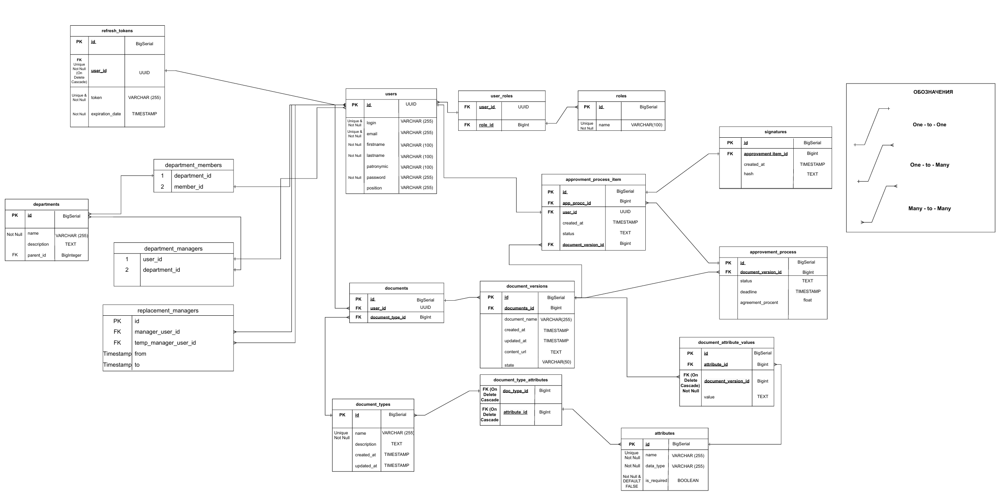
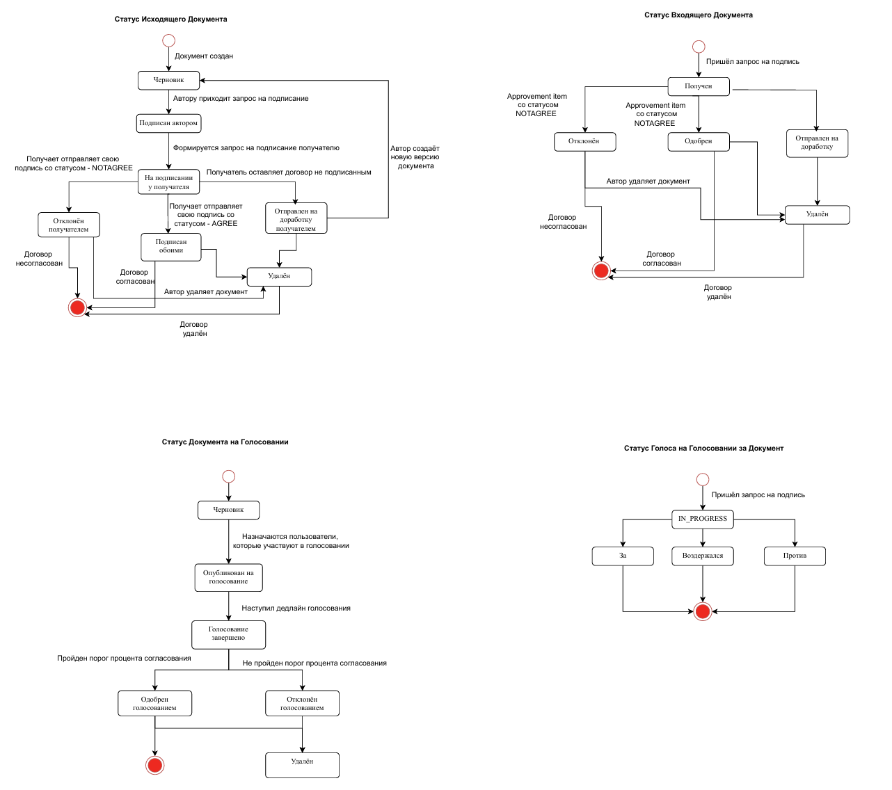

# CaseLab EDM — backend

Backend системы электронного документооборота: документы и версии, согласование,
подписание, голосование, делегирование, атрибуты, аналитика и уведомления.

## Содержание

- [Стек](#стек)
- [Структура репозитория](#структура-репозитория)
- [Быстрый старт](#быстрый-старт)
- [Конфигурация](#конфигурация)
- [Миграции БД](#миграции-бд)
- [Тесты и покрытие](#тесты-и-покрытие)
- [Полный стек в VirtualBox](#полный-стек-в-virtualbox)
- [Автоматический деплой](#автоматический-деплой)
- [Безопасность](#безопасность)
- [Полезные адреса](#полезные-адреса)
- [Документация](#документация)

## Стек

- Java 17, Spring Boot 3
- Spring Security + JWT, Spring Data JPA, Liquibase
- PostgreSQL 14
- MinIO (S3-совместимое хранилище файлов)
- Elasticsearch 8
- Maven Wrapper, JUnit 5, Mockito, AssertJ, H2 для тестов
- Docker / Docker Compose, GitHub Actions

## Структура репозитория

```text
backend/                 Java-приложение, тесты, Dockerfile, Maven Wrapper
docker/                  Compose-файлы для локального запуска и сервера
docs/                    архитектура, безопасность, ТЗ, тестирование
.github/workflows/       CI/CD: тесты, сборка образа, автоматический деплой
.env.example             шаблон переменных окружения (без реальных секретов)
```

## Быстрый старт

### Вариант 1. Всё в Docker

Требуются Docker Engine/Desktop с Compose v2 и свободные порты из
[таблицы адресов](#полезные-адреса).

```bash
cp .env.example .env
# отредактируйте .env: пароли, JWT_SECRET, CORS_ALLOWED_ORIGINS
docker compose --env-file .env -f docker/docker-compose-all.yaml up -d --build
```

Проверка:

```bash
curl http://localhost:8080/api/v1/actuator/health
```

Остановка:

```bash
docker compose --env-file .env -f docker/docker-compose-all.yaml down
```

Данные PostgreSQL, MinIO и Elasticsearch хранятся в именованных volume и переживают
перезапуск контейнеров. Удалить данные: добавить `-v` к команде `down`.

### Вариант 2. Инфраструктура в Docker, backend из IDE

```bash
cp .env.example .env
docker compose --env-file .env -f docker/docker-compose-services.yaml up -d
```

Затем запустите `BackendApplication` в IDE с профилем `dev`. Переменные окружения
можно задать в run configuration или в `.env`, подключённом IDE. Профиль `dev`
ожидает PostgreSQL на `localhost:5432`, MinIO на `localhost:9000`,
Elasticsearch на `localhost:9200`.

### Первый администратор

Миграции больше не создают демонстрационных пользователей и подразделений. Для
пустой базы администратор создаётся один раз через явные переменные окружения:

```dotenv
BOOTSTRAP_ADMIN_ENABLED=true
BOOTSTRAP_ADMIN_LOGIN=admin
BOOTSTRAP_ADMIN_EMAIL=admin@example.com
BOOTSTRAP_ADMIN_PASSWORD=<длинный случайный пароль>
```

После успешного создания администратора установите
`BOOTSTRAP_ADMIN_ENABLED=false` и перезапустите приложение. Пароль нигде в
репозитории не хранится.

## Конфигурация

Приложение читает настройки из переменных окружения. Реальные значения не
коммитятся; `.env` исключён из Git.

| Переменная | Обязательность | Назначение |
|---|---|---|
| `SPRING_PROFILES_ACTIVE` | да | `dev` или `prod` |
| `DATABASE_URL` | да | JDBC URL PostgreSQL |
| `DATABASE_USERNAME` / `DATABASE_PASSWORD` | да | доступ к БД |
| `JWT_SECRET` | да | base64-секрет подписи JWT |
| `JWT_ACCESS_TOKEN_TTL` / `JWT_REFRESH_TOKEN_TTL` | нет | сроки жизни токенов |
| `CORS_ALLOWED_ORIGINS` | да | список origin через запятую |
| `MINIO_ENDPOINT` | да | внутренний адрес MinIO |
| `MINIO_PUBLIC_ENDPOINT` | да | внешний адрес для presigned URL |
| `MINIO_ACCESS_KEY` / `MINIO_SECRET_KEY` | да | доступ к MinIO |
| `MINIO_BUCKET` | нет | имя bucket |
| `ELASTIC_ENDPOINT` | да | адрес Elasticsearch |
| `ELASTIC_REINDEX_ON_STARTUP` | нет | переиндексация при старте |
| `MAIL_HOST` / `MAIL_PORT` | да (prod) | SMTP-сервер; локально можно оставить пустыми |
| `MAIL_USERNAME` / `MAIL_PASSWORD` | да (prod) | SMTP-учётные данные |
| `OPENAPI_SERVER_URL` | да | публичный URL API для Swagger |
| `BOOTSTRAP_ADMIN_*` | нет | разовое создание администратора |

Полный шаблон: [.env.example](.env.example). Для production значения хранятся
только в GitHub Environments/Secrets и в защищённом `.env` на сервере.

## Миграции БД

Схема управляется только Liquibase:

- мастер-файл: `backend/src/main/resources/liquibase/db.master.xml`;
- изменения версионируются в `liquibase/<версия>/`;
- Hibernate работает с `ddl-auto=validate` и не меняет схему;
- новые изменения добавляются отдельным changeset, существующие не редактируются.

При старте приложение проверяет соответствие схемы и падает, если миграция не
применена или сущность расходится с БД. Это намеренное поведение.

## Тесты и покрытие

Тесты не требуют Docker и не используют Testcontainers: H2 + Liquibase поднимают
схему в памяти.

```bash
cd backend
./mvnw -ntp clean verify
```

Windows PowerShell:

```powershell
cd backend
.\mvnw.cmd -ntp clean verify
```

`verify` запускает unit/интеграционные тесты, проверяет JaCoCo и собирает jar.
Минимальное покрытие строк — 90%; при снижении сборка падает. Отчёт:
`backend/target/site/jacoco/index.html`.

Тестовый профиль использует H2 и проверяет ту же Liquibase-схему, что и
production (`ddl-auto=validate`). Подробнее: [docs/TESTING.md](docs/TESTING.md).

## Полный стек в VirtualBox

Если Docker Desktop локально недоступен, полный стек можно проверить в
VirtualBox:

1. Создайте VM с Ubuntu Server 22.04/24.04, 4 CPU, 8 ГБ RAM, 40 ГБ диска.
2. Установите Docker Engine и Compose plugin по официальной инструкции Docker.
3. Установите Git, клонируйте репозиторий на ветку с изменениями.
4. Скопируйте `.env.example` в `.env` и заполните значения; `.env` не коммитьте.
5. Запустите `docker compose --env-file .env -f docker/docker-compose-all.yaml up -d --build`.
6. Пробросьте порт 8080 через NAT VirtualBox и проверьте
   `http://<vm-host>:8080/api/v1/actuator/health`.
7. Выполните smoke-сценарий: вход, создание документа, загрузка версии,
   отправка на подписание, подписание, скачивание файла, проверка запрета доступа
   для чужого пользователя.

Для проверки production-конфигурации используйте `SPRING_PROFILES_ACTIVE=prod`
и отдельные тестовые секреты. Не применяйте production-секреты в тестовой VM.

## Автоматический деплой

Нормальный путь один: merge/push в `main`.

```text
push в main
  → GitHub Actions: тесты + JaCoCo
  → сборка и публикация Docker-образа
  → SSH на сервер
  → docker compose pull/up
  → health-check /api/v1/actuator/health
```

Workflow: `.github/workflows/main-workflow.yml`. Деплой выполняется только после
успешных тестов и сборки. Ручной перезапуск контейнеров не требуется и не является
штатным способом выпуска.

Одноразовая настройка сервера и список GitHub Secrets/Environments:
[docs/DEPLOYMENT.md](docs/DEPLOYMENT.md). Адрес сервера хранится только в
секретах GitHub и не должен попадать в репозиторий или документацию.

## Безопасность

- все секреты вынесены в переменные окружения/секреты CI;
- старые секреты из истории Git считаются скомпрометированными и должны быть
  ротированы (JWT, SMTP, БД, MinIO, администратор);
- JWT access-токен короткоживущий, refresh-токен хранится в БД;
- `/jwt/update` доступен с истёкшим access-токеном, но требует валидный refresh;
- скачивание файла разрешено только владельцу документа или участнику согласования;
- CORS ограничен явным списком origin;
- контейнеры работают от непривилегированного пользователя, порты БД/MinIO/ES
  опубликованы только на localhost (кроме API и публичного MinIO endpoint).

Правила и порядок ротации: [docs/SECURITY.md](docs/SECURITY.md).

## Полезные адреса

| Сервис | Локальный адрес |
|---|---|
| API | `http://localhost:8080/api/v1` |
| Swagger UI | `http://localhost:8080/api/v1/swagger-ui/index.html` |
| OpenAPI JSON | `http://localhost:8080/api/v1/v3/api-docs` |
| Health | `http://localhost:8080/api/v1/actuator/health` |
| MinIO API | `http://localhost:9000` |
| MinIO Console | `http://localhost:9090` |
| Elasticsearch | `http://localhost:9200` |
| PostgreSQL | `localhost:5432` |

## Документация

- [docs/ARCHITECTURE.md](docs/ARCHITECTURE.md) — слои, границы транзакций, потоки.
- [docs/SECURITY.md](docs/SECURITY.md) — модель угроз, секреты, ротация, аудит.
- [docs/DEPLOYMENT.md](docs/DEPLOYMENT.md) — CI/CD, окружения, сервер, откат.
- [docs/TESTING.md](docs/TESTING.md) — тесты, покрытие, VirtualBox, smoke-сценарий.
- [docs/REFACTORING_PLAN.md](docs/REFACTORING_PLAN.md) — техническое задание и
  последовательность выполненных задач.

## Схема БД и статусы





## Правила веток и PR

- базовая ветка для новой работы — `dev`;
- имя ветки: `feature/<краткое-описание>`, `fix/<краткое-описание>`;
- коммиты: `feat:`, `fix:`, `test:`, `docs:`, `chore:`;
- PR требует зелёного CI и ревью; merge в `main` автоматически запускает деплой.
